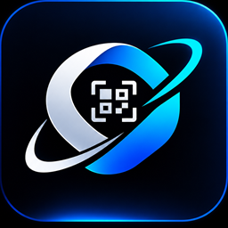

  

  <h1>OptimaSN</h1>
  <h3>International Digital Inventory Management System</h3>

  
<b>Unlimited Products. Smarter Inventory. Complete Business Control.</b>

  

    
    
    
    
  

   

  

  

  

  

    

  

    <a href="#download">Download</a> &nbsp;|&nbsp;
    <a href="#requirements">Requirements</a> &nbsp;|&nbsp;
    <a href="#how-to-install-windows">Install Guide</a> &nbsp;|&nbsp;
    <a href="#first-time-setup">First-Time Setup</a> &nbsp;|&nbsp;
    <a href="#ports-and-network-access">Ports</a> &nbsp;|&nbsp;
    <a href="#use-from-phones-and-other-computers">Phones and Other PCs</a> &nbsp;|&nbsp;
    <a href="#license-and-activation">License</a> &nbsp;|&nbsp;
    <a href="#troubleshooting">Troubleshooting</a>
  

  
<b>Created by SD SIFAT</b>

---

## Download

  <table>
    <tr>
      <td align="center" width="260">
        <h3>Windows</h3>
        
Windows 10 or 11, 64-bit

        
      </td>
      <td align="center" width="260">
        <h3>Linux</h3>
        
Coming soon

        
      </td>
      <td align="center" width="260">
        <h3>Live Demo</h3>
        
Try it in your browser

        
      </td>
    </tr>
  </table>

  
Everything needed is included in the installer. No internet connection is required to install.

  
<a href="https://github.com/SINOBI-Melloflex/Optima-SN/releases/latest">All versions and release notes</a>

---

## Requirements

- Windows 10 or Windows 11, 64-bit.
- Administrator rights on the computer, needed once during installation.
- About 500 MB of free disk space, plus room for your data and backups.
- A modern web browser such as Chrome, Edge or Firefox.
- Internet access only for license activation and for checking updates.
- For phones and other computers: all devices on the same Wi-Fi or network.

---

## How to install (Windows)

1. Click **Download Windows Installer** above. The file `OptimaSN-Setup.exe` downloads straight away.
2. Double-click the downloaded file and accept the administrator prompt. Follow the wizard. By default OptimaSN installs to `C:\Program Files\OptimaSN`, and you can pick another folder.
3. Wait until the installer finishes. OptimaSN starts automatically in the background and starts again every time Windows starts. You do not need to launch anything manually.
4. Open your browser and go to **http://localhost:4015** (or use the **OptimaSN** shortcut on your desktop).
5. Create your admin account right away, then enter your license key (see [License and Activation](#license-and-activation)).

If Windows shows **"Windows protected your PC"**, click **More info** and then **Run anyway**. This message appears for new software that is not yet widely downloaded.

### Verify your download (recommended)

Download only from this page. To confirm the file is genuine, open PowerShell in the folder where the file was saved and run:

    Get-FileHash .\OptimaSN-Setup.exe -Algorithm SHA256

The result must match the SHA256 value in the `.sha256.txt` file on the [latest release page](https://github.com/SINOBI-Melloflex/Optima-SN/releases/latest). If it does not match, do not run the file. Files from any other website are not official.

### Updates

1. Open **System** inside OptimaSN.
2. Press **Check for Update**.
3. If a new version exists, press **Install update**. The app updates itself and restarts.

Your data is never touched by an update. Your license and backups stay as they are.

### Uninstall

Open **Windows Settings > Apps > Installed apps**, find **OptimaSN** and choose **Uninstall**. Copy your backup folder somewhere safe first.

---

## First-time setup

After installing, follow these steps once:

1. Open **http://localhost:4015** on the computer where OptimaSN is installed.
2. **Create your admin account** and choose a strong password.
3. **Activate your license** with the key from your supplier.
4. Add your product categories and products.
5. Create other users and roles from the **Users** page if staff will use the system.
6. Open the **System** page and note the network address if you want to use phones or other computers (see below).
7. Copy your backup folder to another disk or USB drive regularly.

---

## Ports and network access

OptimaSN runs as a small web server on the computer where it is installed. Staff use it through a web browser.

| Port | Used for |
|---|---|
| **4015** | Main OptimaSN web address. On the installed computer use `http://localhost:4015`. |
| **4016, 80 and 443** | Additional local-network ports opened by the installer for secure (https) access and phone camera scanning. The **System** page shows which address to use. |

The installer opens these ports in Windows Firewall for **local network addresses only** (`10.x.x.x`, `172.16-31.x.x` and `192.168.x.x`). They are **not** opened to the public internet, so people outside your network cannot reach OptimaSN.

The **System** page inside OptimaSN always shows the exact addresses to use. If you are unsure which address to type on another device, copy it from there.

---

## Use from phones and other computers

1. Make sure the other device is on the **same Wi-Fi or network** as the OptimaSN computer.
2. On the OptimaSN computer, open **System** and find the network address.
3. Type that address in the browser of the phone or other computer.
4. Log in with your OptimaSN username and password.

**Phone camera scanning:** phones only allow camera access on secure pages. Use the **secure (https) address** shown on the System page. Your browser will show a certificate warning the first time because the certificate is created on your own computer. Choose to continue, and the camera will then work.

**Keep the OptimaSN computer on.** Other devices can connect only while that computer is running and connected to the network.

---

## Backups and your data

- OptimaSN stores all your data on **your own computer** in the `data` folder inside the installation folder.
- A database backup is made automatically **every 4 hours**.
- Backups are saved in the backup folder set during installation. If none was set, the default is `C:\ProgramData\OptimaSN\Backups`.
- The **System** page shows the database health status and has a **Sync Backup** button that runs a database check.
- Copy the backup folder to **another disk or USB drive regularly**. A backup on the same disk will not help if that disk fails.

---

## Linux

**Coming soon.** The Linux version is being prepared and is not available for download yet.

Until it is released, you can:
- Use OptimaSN on Windows (see [Download](#download)).
- Try the [Live Demo](https://optima.ranonline.com.bd/) in any browser, including Linux.
- Open an [issue](https://github.com/SINOBI-Melloflex/Optima-SN/issues) to be told when it is ready.

---

## Live demo

Explore the OptimaSN interface in your browser without installing anything: **[Open OptimaSN Live Demo](https://optima.ranonline.com.bd/)**

---

## Overview

**OptimaSN** is a powerful, universal and comprehensive Digital Inventory Management System designed to manage products, inventory, sales, purchases, warranties, customer accounts, vendor accounts and complete business financial operations from one centralized platform.

Unlike traditional inventory software designed for specific product categories, OptimaSN is built to support different types of products across different industries and businesses.

Whether you manage ISP equipment, networking devices, electronics, computer accessories, mobile devices, office supplies or other products, OptimaSN provides a complete solution for managing your business inventory.

OptimaSN is not just a QR scanner or stock management application. It is a complete digital business management ecosystem that combines inventory operations, sales, purchases, customer ledgers, vendor ledgers, payment tracking, returns, refunds, cash management and business analytics.

With support for compatible QR/barcode scanners and camera-based scanning, users can manage products through dedicated scanning devices, desktop cameras or mobile phone cameras.

**From product entry to final sales, warranty checks, returns, refunds and financial reporting, everything is managed in one place.**

---

## Core Features

- **Universal Product Management:** Manage different types of products without being restricted to a specific industry.
- **QR Code Scanning:** Add and identify products using QR code scanning workflows.
- **Barcode Scanning:** Support product identification through compatible barcode scanning workflows.
- **Camera-Based Scanning:** Use desktop, laptop or mobile phone cameras for supported scanning operations.
- **Complete Inventory Management:** Manage stock, sold quantities, available products and inventory value.
- **Stock-In Management:** Add incoming products and maintain stock records.
- **Sales Management:** Process product sales and maintain transaction history.
- **Purchase Management:** Manage product purchases and stock additions.
- **Warranty Management:** Check product warranty information.
- **Returns and Refunds:** Manage customer returns, refunds and product replacements.
- **Customer Ledger:** Maintain customer balances, dues and transaction records.
- **Vendor Ledger:** Manage supplier accounts, balances and outstanding payments.
- **Due Collection:** Track and collect outstanding customer payments.
- **Vendor Payments:** Record payments made to suppliers and monitor vendor balances.
- **Cash Management:** Monitor cash received, cash paid and current cash position.
- **Operational Cost Management:** Track business expenses and operational costs.
- **Business Analytics:** Monitor sales, profit, stock value and financial performance.
- **Reports and Charts:** Visualize business performance through dashboard analytics.
- **User Management:** Manage users and system access.
- **Role and Permission Management:** Control access to different system modules.
- **Automatic Backups:** A database backup is made automatically every 4 hours.
- **Built-in Updates:** Check for and install new versions from inside the application.

---

## Product and Inventory Management

- Add new products to inventory.
- Manage product information and records.
- Identify products through supported QR codes and barcodes.
- Use compatible scanning devices.
- Scan products using desktop and mobile cameras.
- Track available stock quantities.
- Monitor sold products and remaining stock.
- View total inventory value.
- Identify low-stock and out-of-stock products.
- Review product-wise stock information.

---

## Smart QR, Barcode and Camera Scanner

OptimaSN is not limited to dedicated scanner machines. The system supports flexible product scanning workflows using compatible scanners and camera-enabled devices.

- QR Code Scanner
- Compatible Barcode Scanner
- Desktop Camera
- Laptop Camera
- Mobile Phone Camera

Phone camera scanning works on your local network using the secure (https) address shown on the System page. See [Use from phones and other computers](#use-from-phones-and-other-computers).

---

## Sales and Purchase Management

### Sales Management

- Process product sales and maintain sales transaction records.
- Track customer purchases and monitor total sales.
- View recent sales history and product-wise sales performance.
- Access invoice information and monitor sales trends.
- Track sold product quantities.

### Purchase and Stock-In Management

- Record incoming products and add them to inventory.
- Maintain stock-in records and track product quantities.
- Support cash and credit-based purchase workflows.
- Monitor purchase-related financial records.

---

## Warranty Management

- Check product warranty information.
- Access warranty-related product details.
- Maintain warranty information within product records.
- Support warranty checks during product management and customer service operations.

---

## Returns, Refunds and Replacements

- Process customer product returns and record refund transactions.
- Track returned products and manage products returned to stock.
- Monitor replacement products and record return reasons.
- Track rejected return requests and review refund history.
- Monitor total refunded amounts, cleared amounts and replacement-related payments.

---

## Customer Management and Ledger

- Maintain customer records and track customer-wise outstanding balances.
- Manage credit-based transactions and monitor customer dues.
- Record due collections and track received payments.
- Review customer transaction information and financial summaries.
- Monitor total receivable amounts.

---

## Vendor and Supplier Management

- Maintain vendor-related financial records and outstanding balances.
- Record payments made to vendors and monitor total vendor payables.
- Manage vendor-related returns and refunds.
- Review vendor payment history and supplier financial activities.

---

## Ledger and Financial Management

OptimaSN integrates business financial tracking with inventory operations.

- Customer Ledger and Vendor Ledger
- Customer Due Tracking and Vendor Payables
- Due Collection and Vendor Payments
- Cash Received and Cash Paid
- Credit Transactions
- Outstanding Balance Tracking
- Money Position Overview
- Financial Transaction Records

---

## Cash Management and Operational Costs

### Money Position

- Total money receivable from customers and outstanding customer dues.
- Recovered money.
- Total money payable to vendors and vendor outstanding balances.
- Cash received, cash paid and current cash position.

### Operational Cost Management

- Record operational expenses and track monthly operating costs.
- Monitor all-time operational costs and total business costs.
- Analyze net profit, cost trends and expense categories.

---

## Dashboard and Business Analytics

- Total Sales, Today's Sales and Total Profit
- Stock Value, Available Stock and Sold Products
- Customer Dues and Vendor Payables
- Money Received, Money Paid and Cash Position
- Operational Costs and Returns and Refunds
- Sales Trends and Cost Trends
- Top-Selling Products and Low-Stock Alerts
- Product-Wise Stock Distribution
- Recent Sales Records
- Outstanding Customer Balances and Vendor Payment Summaries

---

## User and System Administration

- User Management
- Role Management
- Permissions Management
- Activity Logs
- System Settings and Network Access Information
- Update Management
- Due Collection, Vendor Payables, Invoice Management and Operational Cost Management

---

## Application Screenshots

### Main Dashboard

### Money Position and Operational Costs

### Returns and Refunds Management

### Sales and Inventory Overview

---

## Universal Business Support

OptimaSN is designed to support flexible inventory workflows for businesses across different industries. It is not restricted to ISP products or networking equipment.

- ISP and Networking Equipment Management
- Electronics and Accessories
- Computer and IT Products
- Mobile Devices and Accessories
- Office Supplies
- Hardware and Equipment
- Wholesale and Retail Inventory
- General Product-Based Businesses
- Technology and Digital Product Businesses

---

## Why Choose OptimaSN?

| Feature | Benefit |
|---|---|
| Universal Inventory | Manage different types of products |
| QR Scanning | Faster product identification |
| Barcode Scanning | Simplified product lookup |
| Camera Scanning | Scan using mobile or computer cameras |
| Stock Management | Monitor inventory levels |
| Sales Management | Organize product sales |
| Warranty Checking | Access warranty information |
| Customer Ledger | Track customer balances |
| Vendor Ledger | Manage supplier accounts |
| Due Collection | Monitor outstanding payments |
| Vendor Payments | Track supplier payments |
| Returns and Refunds | Manage returned products and refunds |
| Cash Management | Monitor business cash position |
| Analytics | Understand business performance |
| Operational Costs | Track business expenses |
| Easy Install and Update | One installer, one-click updates |

---

## Security and Access Management

OptimaSN includes user and role-management functionality to support controlled access to system modules.

- Your data is stored on your own computer.
- Create your admin account immediately after installing and use a strong password.
- Network access is limited to your local network by the Windows Firewall rules created during installation.
- Copy your backup folder to another disk or USB drive regularly.
- Official installers are published only on this GitHub page. Always verify the SHA256 checksum as described in [Verify your download](#verify-your-download-recommended).

---

## License and Activation

OptimaSN runs with a license key from your supplier. Enter the key on the activation page the first time you open the app. The license is checked online, and the app keeps working for up to 7 days if the internet is temporarily unavailable.

- **Check your license:** [Open the License Check page](https://sinobi-melloflex.github.io/Optima-SN-License/check/) and type your key to see if it is active and when it expires.
- **Renew or extend:** contact your supplier.

---

## Troubleshooting

**The page http://localhost:4015 does not open.**
Wait about 30 seconds after installing or after starting Windows, then refresh. OptimaSN starts in the background with Windows. If it still does not open, restart the computer.

**Another phone or computer cannot connect.**
Check that both devices are on the same Wi-Fi or network. Use the address shown on the **System** page, not `localhost`. Make sure the OptimaSN computer is on and not sleeping.

**The phone camera does not open for scanning.**
Use the secure (**https**) address from the System page and accept the certificate warning once.

**Windows says "Windows protected your PC".**
Click **More info**, then **Run anyway**. Only do this for the file downloaded from this page.

**The license is not accepted.**
Check the key on the [License Check page](https://sinobi-melloflex.github.io/Optima-SN-License/check/). Make sure the computer has internet access for activation. If the key is expired or invalid, contact your supplier.

**I want to move OptimaSN to a new computer.**
Copy your backup folder to the new computer, install OptimaSN there, and contact your supplier for the license.

---

## Support

For technical support, project inquiries, feature discussions or collaboration, please contact the OptimaSN project team or [open an issue](https://github.com/SINOBI-Melloflex/Optima-SN/issues) on this page.

---

  

  <h2>OptimaSN</h2>

  <h3>Unlimited Products. Unlimited Possibilities.</h3>

  
<b>One Platform. Complete Inventory Control.</b>

  
Created with dedication by <b>SD SIFAT</b>

  

    <a href="https://github.com/SINOBI-Melloflex/Optima-SN/releases/latest/download/OptimaSN-Setup.exe">Download for Windows</a>
    &nbsp;|&nbsp;
    <a href="#linux">Linux (coming soon)</a>
    &nbsp;|&nbsp;
    <a href="https://optima.ranonline.com.bd/">Live Demo</a>
    &nbsp;|&nbsp;
    <a href="https://sinobi-melloflex.github.io/Optima-SN-License/check/">License Check</a>
  

  (c) OptimaSN. All Rights Reserved.

Admin only: <a href="https://sinobi-melloflex.github.io/Optima-SN-License/admin/">Sign in</a>

